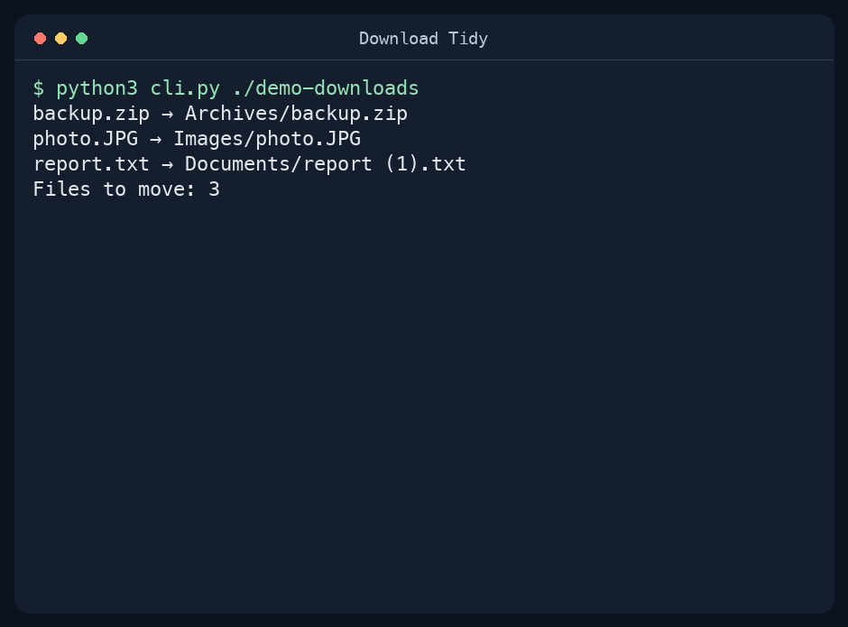

# 📂 Download Tidy

**Preview where your files will go. Organize them when you're ready.**

Download Tidy is a lightweight Python CLI that sorts loose files into folders by extension. Use it on your Downloads folder, Desktop, or any directory you choose.



## What it does

- **Preview first.** See the destination of each file and the total number of planned moves.
- **Apply when ready.** Add `--apply` to move the files and create category folders as needed.
- **Keep both files when names collide.** If `Documents/report.txt` already exists, the incoming file becomes `report (1).txt`.
- **Continue after individual errors.** See which files failed, why, and how many moves succeeded.

## Quick start

Requires **Python 3.9+**. No packages to install.

Run these commands from the project directory. The first two lines create a disposable copy of the sample files so you can repeat the demo.

```bash
demo_dir=$(mktemp -d)
cp -R demo-downloads "$demo_dir/downloads"

python3 cli.py "$demo_dir/downloads"
python3 cli.py "$demo_dir/downloads" --apply
python3 cli.py "$demo_dir/downloads"
```

The demo moves three files. The final preview shows `Files to move: 0`.

### Organize your own files

| Folder | Preview | Apply |
| --- | --- | --- |
| Downloads | `python3 cli.py ~/Downloads` | `python3 cli.py ~/Downloads --apply` |
| Desktop | `python3 cli.py ~/Desktop` | `python3 cli.py ~/Desktop --apply` |

For a path with spaces, wrap it in quotes, for example `python3 cli.py "$HOME/Work Files"`.

## Supported file types

| Folder | Extensions |
| --- | --- |
| `Documents` | `.pdf`, `.doc`, `.docx`, `.txt` |
| `Presentations` | `.pptx` |
| `Images` | `.jpg`, `.jpeg`, `.png` |
| `Audio` | `.mp3` |
| `Code` | `.py`, `.ipynb`, `.patch` |
| `Data` | `.json`, `.csv` |
| `Archives` | `.zip`, `.gz`, `.7z` |

Extensions are case-insensitive, so `photo.JPG` goes to `Images`. Download Tidy scans only the top level of the selected directory and skips hidden files, symbolic links, subfolders, and unsupported extensions.

## How it works

| File | Responsibility |
| --- | --- |
| `cli.py` | Parses arguments with `argparse` and prints the preview or move summary. |
| `organizer.py` | Builds the move plan with `pathlib`, reserves available filenames, and moves files with `shutil`. |
| `demo-downloads/` | Contains sample files and two reports with the same name to demonstrate collision handling. |